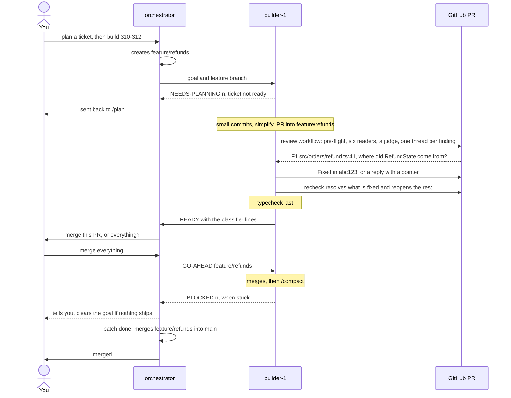

# outputty

A Claude Code plugin for developing projects with [Herdr](https://herdr.dev), the terminal workspace manager for coding agents.

- I decide what to build, and I review what was built.
- Everything in between runs on rules, one session per tab.
- Without Herdr the same flow works by hand: one `claude --worktree` per session.

## The flow



Each lane but the last is a session. The last is the PR on GitHub, which holds the review's threads.

- `/research` and `/prototype` run in their own tabs. `/research` ends in a document that `/plan` reads, and `/prototype` ends in a branch that `/plan` reads.
- `/plan` files tickets that state the why and the end state, never the how.
- `/dream` turns friction in past sessions into measured edits to the skills, rules and `CLAUDE.md`.

## Install

```bash
claude plugin marketplace add outputty/claude-plugin
claude plugin install outputty@outputty
```

Then inside the repo, once: `/outputty:init`.

- It copies the rule files and the README template under `~/.claude/`, and the templates and settings into the repo.
- It reads the repo with one agent per source, then drafts the repo's `CLAUDE.md` with me and writes it only on my yes.
- It ends by adding the repo's check commands to the allowlist, creating the tracker's labels and writing the board ids into `CLAUDE.md`.
- Re-running it prints, per file, `unchanged` or `kept, differs from <template>`.

Requirements: Claude Code 2.1.247 or later, Herdr on `PATH`, `gh` 2.96 or later with a GitHub Project that has a Status field, and Fable access for the advisor. A ticket labelled `stack` also needs `gh extension install github/gh-stack`.

## Update

```bash
claude plugin marketplace update outputty
claude plugin update outputty@outputty
```

Then run `/reload-plugins` or start a new session, since a session pins the plugin files when it loads.

## The sessions

A research, plan or prototype session opens as its own Herdr tab with `claude --worktree`, on its own model, with its prompt already sent. The orchestrator and the builders share the agents tab.

### Research

`/research <topic>` runs on Opus 5.5, started with `--effort ultracode`.

- It grills me until every base is covered.
- It fans out Haiku and Sonnet agents that gather and categorize.
- It validates each finding against its source and redoes the research that fails.
- It ends with `docs/research/<slug>.md` in a PR, which `/plan` can read. It files no ticket.

### Planning

`/plan <idea>` runs on Opus 5.5, and I sit in it.

- It interviews me until nothing answerable is left, and shows every level a fix could land at with what it changes and breaks.
- On my yes it files one ticket: the end state, Implementation criteria, and what must land first.
- Its running record lives in a scratch file outside the repo, so a restarted session resumes.
- A build that hits a design question labels the ticket `needs-planning`, and `/plan <n>` reopens it.

### Prototyping

`/prototype <idea or n>` runs on Haiku, when I want to see it working before I settle it.

- It writes a test per requirement first, then wires the fastest path through patterns the repo already has.
- Anything new is stubbed and marked as a stub.
- The work lands on a `prototype/<name>` branch on GitHub, which `/plan` reads and a ticket's **Base** can name.

### Building

`/build` runs on Haiku for a ticket that is well defined and small in scope, else Sonnet, one worktree per build, started with `--effort ultracode`.

- `/tickets` lists what is open, with blockers and priority, and prints the goal line for one ticket and a loop goal line over every buildable ticket. A named set of tickets gets its own line.
- Per ticket the build posts its layer plan, builds layer by layer onto one PR, simplifies the diff, runs its review, fixes what the review posts, and writes the docs last.
- It runs every Implementation-criteria case and pastes the real output. The `/goal` judge reads those outputs.
- It takes the first buildable ticket whose body leaves no ruling open and has a **How to validate**. Any other ticket is labelled `needs-planning` and reported to the orchestrator as `NEEDS-PLANNING #<n>`, and the build asks me nothing.
- It commits one action at a time, about 400 lines of code at most, tests and docs aside, with the why in the message.
- It runs the typecheck command and writes type-level tests only after the last layer, the last PR of a stack, unless the ticket is about aligning typechecks.
- Blocked, it calls the advisor, ships the part that can ship, files the rest as a ticket and sends `BLOCKED #<n>` to the orchestrator. When nothing can ship and other tickets depend on it, the orchestrator clears the goal and tells me.
- A ticket labelled `stack` gets one PR per layer instead.
- A ticket blocked by an open, unmerged PR branches from that PR's branch. Its own PR targets the feature branch, or `main` when none is named.
- The advisor reinforces what exists and never enables a new pattern. On a Fable session the build makes no `advisor` call. Where a clean context helps, it starts an agent briefed for the task.

### The agents tab

One tab per workspace shows the orchestrator and the builders, which message each other with `herdr agent prompt`:

```text
┌─────────────────────────┐
│ orchestrator (Sonnet)   │
├─────────────────────────┤
│ builder-1               │
├─────────────────────────┤
│ builder-2               │
└─────────────────────────┘
```

- Agent names carry the repo's name as a prefix, such as `shop-orchestrator` and `shop-builder-1`, because herdr agent names are unique across every workspace; the box above shows the roles.
- The first session in a repo's own checkout, with no orchestrator of that repo in `herdr agent list`, renames itself `<repo>-orchestrator`. It starts plan and build sessions, hears the builders' blockers, tells me, and clears a goal that cannot be met.
- A builder that finds no `orchestrator` starts one with its blocker as the first prompt.
- A builder asks me directly only when work cannot continue, or the premise is flawed and the advisor gives no clear answer.
- Every builder starts with `--permission-mode bypassPermissions` and `--effort ultracode`.

### Reviewing

A build reviews its own PR with the saved `review` workflow, so no second session runs. Ultracode lets a builder run a workflow, and the build runs one only for the review.

- The workflow loads from the installed skill, never from the PR, so a builder cannot edit its own review. It receives the PR number and nothing else from the builder.
- The pre-flight reads the commits first, in plain code on counts from a Haiku agent: no commit carries most of the code lines, and every message has a body that says why. A failing pre-flight stops the review, and the builder redoes those commits; whether a commit does one action is the judge's call.
- Six Sonnet readers check the PR: Standards, Spec, Correctness, Provenance, Tests and Simplicity. An Opus judge assumes the builder lies, opens every cited source itself, and clears a finding only on a source it opened.
- Provenance: every new type, pattern, abstraction, dependency and file traces to a ticket line, the plan comment or a sibling on `main`.
- Tests: every new test names the Implementation criterion it proves.
- Simplicity: the reader names the smallest change that meets the criteria and compares it to the diff; reuse and deletion win.
- Each finding becomes a thread on the PR, and so does each valid question the judge would have asked the builder:

```text
[review F3 provenance] src/orders/refund.ts:41 adds RefundState; no ticket line, plan line or sibling names it.
Q: where did RefundState come from? Source or no proof.
```

- The builder fixes with one commit per fix and replies in the thread with the commit or one pointer, or `no proof` and removes the change. It never resolves a thread.
- A recheck then opens the source behind each open thread and the fix commits only. It resolves a thread, answers it or reopens it, and reopens one the builder resolved. It runs at most twice; threads still open after that stay on the PR for me.

### The merge rule

After the review, a Haiku classifier reads the whole PR diff and reports three things: a public API change, possibly breaking functionality, and a major refactor.

- The classifier's three lines ride in the `READY` message to the orchestrator, which asks me: merge this PR, or everything in the batch?
- A batch is one `/goal` run. The orchestrator creates `feature/<slug>` from `main`, and every builder's PRs target it.
- On "everything", the orchestrator sends `GO-AHEAD feature/<slug>` to the batch's builders, which merge each PR into the feature branch until a `STOP feature/<slug>`. A stacked ticket sends one `READY` for its top PR.
- When the batch is in, the orchestrator opens the feature branch's PR into `main`. If I said "merge everything", it merges that PR itself and tells me; otherwise it asks me first.

A merge that deploys always waits for me.

## What ships, what it copies

The plugin ships its skills, a SessionStart hook and a forced output style. An upgrade reaches every session.

- **Plugin skills**, typed `/outputty:<name>`: `init`, `herdr` (opens each tab), `dream` (turns friction in past transcripts into measured, committed edits), `eval` (measures a change to the style, hook, rules or a skill).
- **User skills**, copied by `init` to `~/.claude/skills/outputty-<name>/` and typed `/<name>`: `plan`, `prototype`, `research`, `tickets`, `build`, `review`, `audit`, `tracker`, `documentation`, `typescript-node`, `ts-pattern`, `tsup`. The copy is mine, and an upgrade never overwrites it.
- **Rules**: `~/.claude/rules/outputty-code.md` for any language, and `outputty-typescript.md` for `.ts` files.
- **Repo level**: `CLAUDE.md` drafted at init, `.github/` ticket and PR templates, and `.claude/settings.json`.

After an upgrade, `init` prints what a template changed as offers and writes nothing into my copy.

`/outputty:dream` starts from `friction.ts`, which prints one JSON line per flagged window:

```bash
bun skills/dream/scripts/friction.ts __tests__/fixtures/friction/reread.jsonl
```

```text
{"session":"reread","start":"2026-11-20T10:00:00Z","end":"2026-11-20T10:05:30Z","toolCalls":11,"repeatReads":[{"path":"/repo/tracker/SKILL.md","count":4}],"durationMs":330000,"corrections":0,"skillsLoaded":["build","tracker"]}
```

## Where a repo keeps things

The plugin names no layout. Each repo's `CLAUDE.md` says where each kind of knowledge lives. Mine:

1. **Tests** - the behaviour.
2. **The linter** - the rules a tool can hold.
3. **`.claude/rules/`** - the judgement a tool cannot hold.
4. **`README.md`** - the front door.
5. **Issues in the tracker** - the plan.

Each doc holds current state only. A friction I repeat becomes an edit through `dream`.

## Safety

The scaffold copies no hooks. The plugin runs one, at session start, which only prints its standing lines.

- Every session Herdr opens starts with `--permission-mode bypassPermissions`, so no permission prompt bounds it. `deny` rules still block in that mode, per the [permission modes doc](https://code.claude.com/docs/en/permission-modes); an allow rule has no effect.
- A goal line carries no turn cap. `/goal clear` ends a goal at any time.
- A missing ruling is a question, asked with `AskUserQuestion`, never a guess.
- Nothing merges into `main` unless I merged it or said "merge everything". A PR merges into a feature branch only on a go-ahead I gave, or when I said to merge, and not when the merge deploys.
- One build per worktree. The primary checkout is edited only when I ask for a direct edit there.

`templates/settings.json` is deep-merged into a repo's `.claude/settings.json`. Arrays under `allow`, `deny` and `ask` union with what the repo has, and a `deny` matches at any depth.

```json
{
  "worktree": { "baseRef": "head" },
  "permissions": {
    "allow": ["Bash(git:*)", "Bash(gh:*)"],
    "deny": [
      "Read(.env)",
      "Edit(.env)",
      "Read(.env.local)",
      "Edit(.env.local)",
      "Read(secrets/**)",
      "Edit(secrets/**)",
      "Read(*.pem)",
      "Edit(*.pem)",
      "Read(*.key)",
      "Edit(*.key)",
      "Read(credentials.json)",
      "Edit(credentials.json)",
      "ScheduleWakeup"
    ],
    "ask": ["Bash(rm -rf:*)", "Bash(git clean -f:*)"]
  }
}
```

Not covered:

- **Content-level credential scanning** - a `deny` matches a path only. Use `gitleaks` in CI.
- **`NotebookEdit`** - the secret-path rules do not match it.
- **The audit skill** - read-only by instruction, not by a permission.
- **Advisor spend** - Fable as advisor bills per call, with the whole transcript as input. Watch it with `/usage`.

## What it relies on

- `/goal` is set in the session that does the work, typed or sent as its starting prompt. Its judge skips a turn while a background agent runs.
- `advisorModel` activates only when the advisor outranks the base model.
- `permissions.defaultMode: auto` applies only from user or managed settings, never a project file.
- A plugin has no always-loaded rule, so the standing lines ride a SessionStart hook and `init` copies the code rules to `~/.claude/rules/`.
- `force-for-plugin: true` overrides the user's `outputStyle`. A repo turns the plugin off with `"outputty@outputty": false` in its `.claude/settings.json`.
